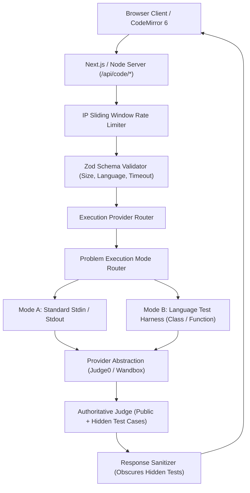

# DSALoop: Online Compiler, Code Execution & DSA Judge Engine
*DSALoop by [CampusLoop](https://campusloop.space/)*

DSALoop provides a production-grade, multi-language coding playground and competitive programming judge integrated directly into every problem and standalone compiler route.

---

## 1. Architecture Overview

The system consists of three unified experiences powered by a shared infrastructure:



1. **Standalone Online Compilers** (`/online-compiler`, `/online-python-compiler`, `/online-cpp-compiler`, etc.): Complete development environments for interactive code execution with custom stdin, compiler diagnostic output, execution time benchmarking, and memory metrics.
2. **Interactive Problem Workspace** (`/problems/[slug]#workspace`): Real-time CodeMirror 6 editor embedded in every DSA problem with language switching, reference solution loading, and sample test suite runners.
3. **Authoritative Online Judge**: Complete competitive programming judge running code against both public sample tests and private server-side hidden edge cases with verdicts:
   - `ACCEPTED`: All test cases passed within limits.
   - `WRONG_ANSWER`: Output mismatch on test cases.
   - `COMPILE_ERROR`: Compiler diagnostic errors and suggestions.
   - `RUNTIME_ERROR`: Execution crash or non-zero exit code.
   - `TIME_LIMIT_EXCEEDED`: Execution exceeded maximum allowed wall/CPU clock.

---

## 2. Supported Languages & Runtimes

| Language | Version / Engine | Judge0 ID | Wandbox Compiler | Route |
| :--- | :--- | :--- | :--- | :--- |
| **Python 3** | 3.12 (CPython) | 71 | `cpython-3.12.7` | `/online-python-compiler` |
| **C++** | C++20 (GCC 13.2) | 54 | `gcc-13.2.0` | `/online-cpp-compiler` |
| **C** | C17 (GCC 13.2) | 50 | `gcc-13.2.0-c` | `/online-c-compiler` |
| **Java** | Java 21 (OpenJDK) | 62 | `openjdk-jdk-21+35` | `/online-java-compiler` |
| **JavaScript** | Node.js 20.x | 63 | `nodejs-20.17.0` | `/online-javascript-compiler` |
| **TypeScript** | TS 5.6 (Node) | 74 | `typescript-5.6.2` | `/online-typescript-compiler` |
| **Go** | Go 1.23 | 60 | `go-1.23.1` | `/online-go-compiler` |
| **Rust** | Rust 1.82 (2021 ed.) | 73 | `rust-1.82.0` | `/online-rust-compiler` |

---

## 3. Code Execution Providers

The execution engine uses a pluggable `ExecutionProvider` interface (`src/lib/compiler/providers/types.ts`):

- **Judge0 Provider** (`src/lib/compiler/providers/judge0.ts`):
  - Supports self-hosted Judge0 instances (`http://localhost:2358`) and managed CE endpoints (`https://ce.judge0.com`).
  - Base64 encoding/decoding of source code, stdin, and outputs.
  - Asynchronous polling with exponential backoff and timeout safeguards.
  - Configurable via `JUDGE0_API_URL` and `JUDGE0_API_KEY`.
- **Wandbox Provider** (`src/lib/compiler/providers/wandbox.ts`):
  - Zero-auth public CORS provider for instant out-of-the-box execution without credentials.
  - Compiler optimization flags (`-std=c++20 -O2`).

Configure the active provider in `.env`:
```bash
EXECUTION_PROVIDER=auto # "auto", "judge0", or "wandbox"
JUDGE0_API_URL=https://ce.judge0.com
JUDGE0_API_KEY=your_key_here
```

---

## 4. Problem Execution Modes & Test Harnesses

1. **Mode A (Standard I/O)**: Programs implementing `main()` or reading `sys.stdin` directly stream inputs and outputs.
2. **Mode B (Function-based DSA Problems)**: Problems defined as classes or methods (e.g. `class Solution: def twoSum(...)`) are automatically wrapped with language-specific test harnesses (`src/lib/judge/harness.ts`) that serialize JSON or whitespace inputs into method calls and format results for verification.
3. **Mode C (Legacy / Custom Stdin)**: For problems without automated harnesses, users have full interactive access to standard input and compiler execution.

---

## 5. Security & Abuse Prevention

1. **Isolated Execution**: All code runs in sandboxed execution environments via Judge0 or Wandbox containers with non-root privileges.
2. **Size Limits**: Source code capped at 64KB (`MAX_SOURCE_SIZE_BYTES=65536`), stdin capped at 32KB.
3. **Rate Limiting**: Sliding window in-memory rate limiter enforcing maximum 30 requests per minute per IP address.
4. **Authoritative Test Protection**: Private edge test cases are kept on the server. Hidden test inputs and expected outputs are obscured (`[Hidden Test Input]`, `[Hidden]`) in API responses.

---

## 6. API Contracts

### `POST /api/code/run`
Executes code with custom stdin.

**Request:**
```json
{
  "language": "python",
  "code": "import sys\nprint('Hello ' + sys.stdin.read().strip())",
  "stdin": "CampusLoop",
  "timeoutMs": 10000
}
```

**Response (200 OK):**
```json
{
  "status": "success",
  "stdout": "Hello CampusLoop\n",
  "stderr": "",
  "output": "Hello CampusLoop\n",
  "exitCode": 0,
  "executionTimeMs": 28,
  "memoryKb": 1024,
  "provider": "Judge0"
}
```

### `POST /api/code/submit`
Submits code to judge against authoritative public and hidden test cases.

**Request:**
```json
{
  "slug": "two-sum",
  "language": "python",
  "code": "class Solution:\n    def twoSum(self, nums, target):\n        lookup = {}\n        for i, n in enumerate(nums):\n            if target - n in lookup: return [lookup[target - n], i]\n            lookup[n] = i\n        return []"
}
```

**Response (200 OK):**
```json
{
  "verdict": "ACCEPTED",
  "passedCount": 5,
  "totalCount": 5,
  "executionTimeMs": 114,
  "memoryKb": 1024,
  "results": [
    {
      "testCaseId": "case-1",
      "name": "Sample Case 1",
      "passed": true,
      "input": "2 7 11 15\n9",
      "expectedOutput": "[0, 1]",
      "actualOutput": "[0, 1]\n",
      "executionTimeMs": 25
    },
    {
      "testCaseId": "case-3",
      "name": "Hidden Case 1 (Duplicate numbers)",
      "passed": true,
      "input": "[Hidden Test Input]",
      "expectedOutput": "[Hidden]",
      "actualOutput": "[Hidden Output Match]",
      "executionTimeMs": 22
    }
  ]
}
```

---

## 7. Testing & Verification

Run automated tests:
```bash
npm test
```

Run full typecheck and build:
```bash
npm run typecheck
npm run build
```
